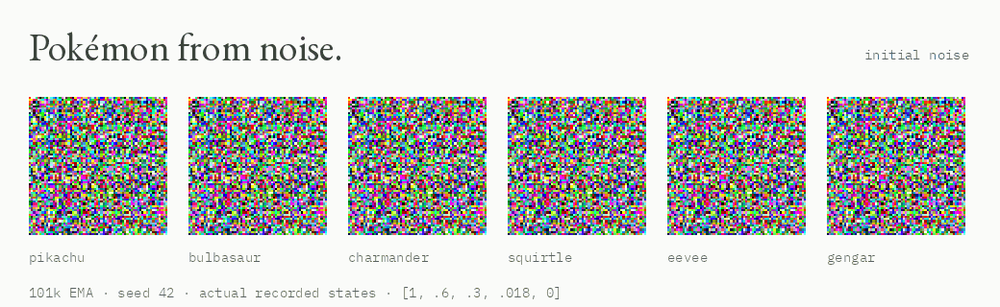

# Pokémon from noise

I trained a Pokémon generator from scratch for KAIST’s [FastGen course project](https://generative-models.kaist.ac.kr/fastgen/). It uses MeanFlow with guidance built into training, so an image takes four network calls.

[**Explore the project page →**](https://ab-rin.github.io/reports-meanflow-cfg-/) · [Code](code/) · [Weights](#weights) · [Technical report](REPORT.md)



*101k EMA, seed 42. Five recorded states, with no interpolated frames. The page includes all 192 samples across 12 species and 16 seeds.*

## Why I wanted to look beyond the score

We were evaluated on FID. I spent a lot of time getting it lower, eventually reaching **19.3469 ± 0.1662** over five generation seeds. But the course’s real train–validation reference was **20.82**. Going below that felt counterintuitive. What was the extra training changing in the images?

I compared the first checkpoint below 22 with the best checkpoint, using the same classes, noise, and four equal sampling steps:

| Checkpoint | FID, remeasured | Active training hours |
| --- | ---: | ---: |
| 64k EMA | 21.9181 | 166.92 |
| 101k EMA | 20.3921 | 268.24 |

That is **101.33 more active hours for 1.5261 lower FID**. The page lets you compare their images before revealing the scores. It also shows one fixed Pikachu seed at six training checkpoints, the loss history, and all 168 recorded FID evaluations.

The baseline check matters too. Using 3,020 real training images, balanced at 20 per class, gave **20.86 ± 0.35** over three subsets. Using all 17,079 training images gave **15.71** against the same 3,020 validation images. Both sample count and class balance change here. This is not an exact reconstruction of the course’s baseline.

The train–validation FID is **not a hard lower bound**. A score below it does not prove worse generation, and these small galleries cannot establish a general visual ranking. The point is to put the number next to the images and the time spent getting it.

[Comparison data and hashes](docs/assets/study/study.json) · [Baseline subsets](docs/assets/study/baseline-sensitivity.json) · [FID bias paper](https://arxiv.org/abs/1911.07023)

## The model

- 56,010,243 parameters; 151 classes; 64 × 64 RGB.
- Random initialization. No pretrained generator or external teacher.
- Original MeanFlow objective with built-in classifier-free guidance: scale 2, label dropout 0.1.
- Adam at 3e−4, effective batch 512, 500-update warmup, EMA decay 0.999.
- One A100 20 GB. The 101k checkpoint took 268.24 active training hours.

After training, I kept the 101k weights fixed and tuned the sampling times. **[1, 0.6, 0.3, 0.018, 0]** improved FID in all five paired confirmation runs against the ρ = 2 schedule. This is where the 19.3469 result comes from; the checkpoint comparison above uses uniform steps instead.

± denotes sample SD across generation seeds with a fixed validation reference. The same reference was reused for checkpoint and schedule selection. These are local measurements, not official TA scores.

## Weights

| Checkpoint | Download | SHA-256 |
| --- | --- | --- |
| 64k EMA | [224 MB](https://github.com/ab-rin/reports-meanflow-cfg-/releases/download/meanflow-cfg-64k/ema_0064000.ckpt) | `8ba96595edd883380a489060d5aa58bd346242ae8279c6491b8fcc80d520ec14` |
| 101k EMA | [224 MB](https://github.com/ab-rin/reports-meanflow-cfg-/releases/download/meanflow-cfg-101k/ema_0101000.ckpt) | `ab99f610b9bc2a8ec26f627573608b52d490065773ede28ab18bf5a940d11b41` |

The [1k, 8k, and 32k training snapshots](https://github.com/ab-rin/reports-meanflow-cfg-/releases/tag/meanflow-cfg-training-snapshots) are also available, with [hashes and loading checks for all five released checkpoints](data/checkpoints.json). The 122k image is shown on the page; its weight file is not included in these downloads.

The files contain EMA model tensors and small training metadata, with no optimizer state or training images. Load with `torch.load(..., weights_only=True)`. Use the exact hashes above to check your downloads.

## Run it

Follow [REPRODUCING.md](REPRODUCING.md) for dependencies, data, and checkpoint setup. From the repository root:

```bash
cd code
python sample.py --checkpoint checkpoints/ema_0101000.ckpt \
  --schedule best4 --classes 103 9 14 129 \
  --samples-per-class 3 --output outputs/four-calls --device cuda
```

Class IDs come from `category_to_id.json`, not Pokédex numbers. Use `--schedule uniform4` for the 64k/101k checkpoint comparison.

The [training code](code/README.md), [full technical report](REPORT.md), and [page asset recipes](docs/README.md) explain the rest. Preview the static page locally with `python3 -m http.server 8000 --directory docs`; it has no build step or external JavaScript dependencies.

## Credits

Method: [Geng et al., Mean Flows for One-step Generative Modeling](https://arxiv.org/abs/2505.13447). Backbone: [Gsunshine/py-meanflow](https://github.com/Gsunshine/py-meanflow), pinned in the source and licensed under [CC BY-NC-SA 4.0](code/src/original_meanflow/LICENSE). My contribution is the task implementation, training, sampling experiments, and analysis.

Page design references: [Jermaine Antwi](https://antwi.dev/) and [Jade Franson](https://www.jadefranson.com/). The page code is original; their assets were not copied. EB Garamond and IBM Plex Mono are self-hosted under the SIL Open Font License. Pokémon belongs to its respective rights holders; this is an unaffiliated course project.
