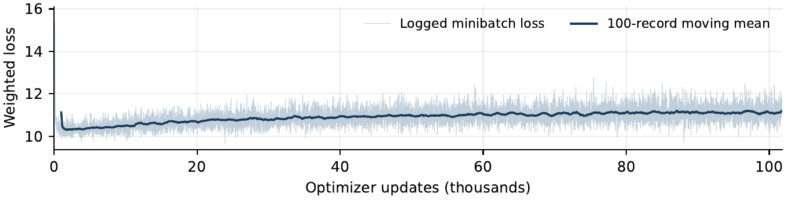
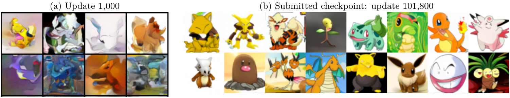

# Four-evaluation MeanFlow for FastGen

Team 06 — four-NFE submission — 7 November 2026

`lucky_dragon`, `bright_koala`, `calm_panda`

[Submitted PDF](report/report_for_submission.pdf) · [LaTeX source](report/report_for_submission.tex) · [Build notes](report/BUILD.txt)

> Markdown adaptation of the submitted report. The PDF and source files are preserved unchanged.

## Overview

We use MeanFlow with built-in classifier-free guidance for class-conditional $64\times64$ RGB Pokémon generation in FastGen \[1,2,5\]. The model learns the average velocity over a time interval, allowing each network evaluation to move directly to the next sampling time. Our submission uses the exponential moving average (EMA) checkpoint at update **101,800** and four network evaluations (4 NFE). It achieves a mean validation FID of **19.0036** with sample standard deviation **0.0828** across five generation seeds.

## Model and training objective

We adapt the Song U-Net in the MeanFlow authors’ PyTorch implementation, with architecture and augmentation code derived from EDM \[2,3\]. The backbone has **56,010,243 parameters**, base width 128, channel multipliers $(2,2,2)$, four encoder blocks per resolution, attention at $16\times16$, GroupNorm \[4\], and dropout 0.2. It predicts interval-average velocity $u_\theta(z,t,r,c)$, conditioned on the start time $t$, interval length $t-r$, and one of 151 classes.

For a training image $x$ and independent Gaussian noise $\epsilon$, we form $z=(1-t)x+t\epsilon$ and $v=\epsilon-x$. Two independent draws from $\mathrm{sigmoid}(\mathcal N(-2,2^2))$ are ordered to obtain $r\leq t$; 25% of examples use $r=t$. We drop the class label with probability 0.1. Dropped-label examples use $g=v$; retained-label examples use guidance scale 2, giving $g=2v-u_\theta(z,t,t,\varnothing)$. The unconditional boundary estimate is detached and evaluated with dropout disabled. The target and loss are

$$
y=\mathrm{sg}\!\left[g-(t-r)\left(\partial_tu_\theta+\partial_zu_\theta\,g\right)\right],
$$

$$
L=\frac{1}{B}\sum_{i=1}^{B}\frac{E_i}{(\mathrm{sg}[E_i]+10^{-3})^{0.75}},
 \quad E_i=\|u_{\theta,i}-y_i\|_2^2.
$$

Here $\mathrm{sg}$ denotes stop-gradient, and $E_i$ sums squared error over all channels and pixels. The Jacobian-vector product holds $r$ fixed and uses $g$ as the spatial tangent. This trains the interval prediction and its guided boundary velocity within the same model.

## Four-evaluation sampling

Starting from $x_1\sim\mathcal N(0,I)$, we apply

$$
x_r=x_t-(t-r)u_\theta(x_t,t,r,c),
$$

$$
(t_0,t_1,t_2,t_3,t_4)=(1,0.6103515625,0.31640625,0.015625,0).
$$

Each interval requires one backbone call. Guidance is learned in the training target, so the four conditional calls complete generation. We clamp the final image to $[-1,1]$.

## Training and compute

Training starts from random weights with seed 42 and uses all **17,079 official training images**. Images are decoded as RGB, resized to $64\times64$, and normalized to $[-1,1]$. We retain horizontal flips and the upstream scale, anisotropy, and translation augmentation (base probability 0.12). Adam uses $(\beta_1,\beta_2)=(0.9,0.999)$, $\epsilon=10^{-8}$, zero weight decay, and no gradient clipping. The learning rate warms from $10^{-8}$ to $3\times10^{-4}$ over 500 updates and remains constant. Effective batch size is 512 through gradient accumulation: microbatch 16 through update 84,276, then 32 through update 100,000. The packaged continuation engine runs the final 1,800 updates with microbatch 32, restoring the model, EMA, optimizer, sampler, and random-number states. EMA updates every step with decay $\min(0.999,(s+1)/(s+10))$, where $s$ is the completed update count.

We train in FP32 with TF32 and compiled JVPs on one NVIDIA GRID A100D-20C (20 GB); evaluation disables TF32. Through update 101,800, logs record **270.12 h** of active training and 276.31 h including evaluation and checkpoint overhead, excluding restart downtime. Exact-state checkpoint recovery required an additional 4.25 h of replay. Peak allocated training memory was **12.431 GB**, measured with `torch.cuda.max_memory_allocated()`.

*Figure 1. Logged weighted MeanFlow training loss through update 101,800, with a moving mean over 100 records (approximately 1,000 updates).*

## Evaluation and selection

We first compared six checkpoints from updates 101,300 to 101,800 using two generation seeds and sampling times $(1,0.6,0.3,0.018,0)$. Update 101,800 had the lowest mean validation FID, 19.1919. We then fixed this checkpoint, screened 24 four-call schedules on one seed, and evaluated the five shortlisted schedules on five fresh shared seeds, 610301101–610301105. Each run generated 3,020 images (20 per class) in batches of 32 and used the same 3,020 official validation images with Clean-FID \[6\]. Matching noise streams across schedules enabled paired comparisons; the screening seed is excluded from the table.

| NFE | Sampling times | Mean FID ↓ | Sample SD |
|:--:|:---|---:|---:|
| 4 | $(1,0.6103515625,0.31640625,0.015625,0)$ | **19.0036** | 0.0828 |
| 4 | $(1,0.6,0.3,0.018,0)$ | 19.0724 | 0.0960 |
| 4 | $(1,0.6,0.3375,0.03,0)$ | 19.2492 | 0.1075 |
| 4 | $(1,0.6,0.3,0.03,0)$ | 19.2669 | 0.1042 |
| 4 | $(1,0.6,0.2625,0.03,0)$ | 19.2821 | 0.1071 |
| 3 | $(1,0.65,0.2,0)$ | 19.6399 | 0.1002 |

*Table 1. Five-seed validation results at EMA update 101,800. The first row is the submitted schedule; the last row is the best tested three-call schedule under the same evaluation protocol.*

The submitted schedule improves mean FID by 0.0688 over the previous four-call schedule and scores lower on all five paired seeds. The best tested three-call schedule is 0.6363 FID higher, supporting our choice of four evaluations. The gain from adjusting four-call times is small, while reducing to three calls produces a larger quality loss in this comparison. These validation scores informed checkpoint and schedule selection. The standard deviations describe generation-seed variation on a fixed validation reference; checkpoint ranking was performed under the earlier schedule.

## Generated samples

Figure 2 shows archived early samples alongside samples from the submitted model. At update 1,000, class colors and rough shapes are visible, with substantial geometry and texture artifacts. The final samples have clearer silhouettes and more consistent class details, although some outlines and textures remain uneven. The panels use different classes and seeds and show the first images in their recorded grids.

*Figure 2. (a) Eight early samples, seed 1234, classes $0,10,\ldots,70$, uniform times $(1,.75,.5,.25,0)$. (b) First 16 samples from the final preview, seed 610301101, using the submitted schedule; sample index zero for the first 16 classes in the recorded 64-class preview.*

## Reproducibility

The submitted `team_06` package contains the EMA weights in `checkpoints/few_nfe.ckpt`, the four-call sampler, training code, and source licenses. The training driver executes the recorded stages from random initialization through update 101,800. Archived checks confirm strict checkpoint loading, the parameter count, and four backbone calls per sampling batch. A local run of the unchanged course evaluator at seed 610301101 reproduced FID 19.11308, with identical generated PNGs and a FID difference below $4\times10^{-7}$ from the saved confirmation run.

The [README comparison](README.md#cumbersome-process-of-fine-tuning-was-not-really-fruitful) and [released weights](README.md#weights) cover the earlier 64k and 101k checkpoints. The submitted 101,800-update checkpoint described here is a separate artifact.

## References and code attribution

1. Z. Geng, M. Deng, X. Bai, J. Z. Kolter, K. He. *Mean Flows for One-step Generative Modeling*. 2025. <https://arxiv.org/abs/2505.13447>.

2. Gsunshine. *py-meanflow*, revision `1f6d72d9`, CC BY-NC-SA 4.0. <https://github.com/Gsunshine/py-meanflow>. Built-in guidance: <https://github.com/Gsunshine/meanflow/blob/main/meanflow.py>.

3. T. Karras et al. *Elucidating the Design Space of Diffusion-Based Generative Models*. NeurIPS 2022. <https://arxiv.org/abs/2206.00364>; architecture and augmentation code: <https://github.com/NVlabs/edm>.

4. Y. Wu, K. He. *Group Normalization*. ECCV 2018. <https://arxiv.org/abs/1803.08494>.

5. KAIST Visual AI Group. *FastGen Challenge* and starter code. <https://generative-models.kaist.ac.kr/fastgen/>; <https://github.com/KAIST-Visual-AI-Group/AIC313-Project-FastGen>.

6. G. Parmar et al. *Clean-FID*, implementation v0.1.35. <https://github.com/GaParmar/clean-fid>. M. Heusel et al. *FID*. NeurIPS 2017. <https://arxiv.org/abs/1706.08500>.
