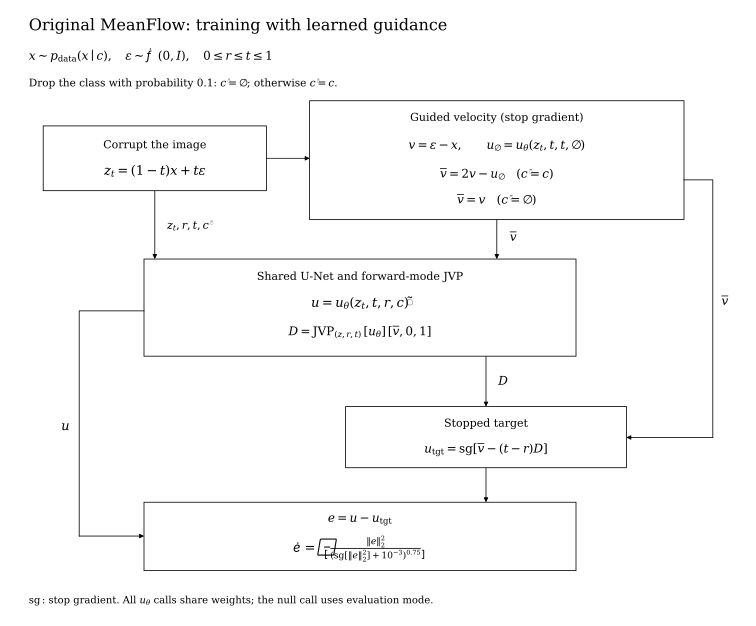
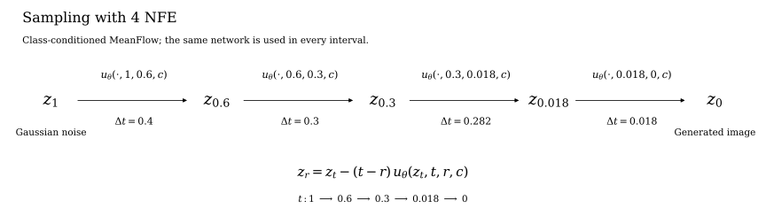
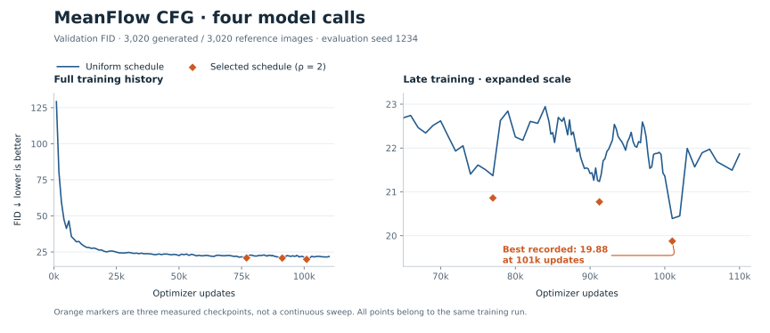

# MeanFlow with classifier-free guidance

> Historical report, preserved from the original repository. The [project page](docs/index.html) and [new measurements](docs/assets/study/study.json) add the later 122k continuation, checkpoint comparison, and real-data baseline checks.

This repository contains the training code, sampling code, and results for a class-conditional Pokémon generator. The model learns average velocity with the original MeanFlow objective and incorporates classifier-free guidance during training.

The selected **101,000-update EMA checkpoint** reaches **19.3469 ± 0.1662 FID** over five generation seeds using four evaluations and the schedule **[1, 0.6, 0.3, 0.018, 0]**. The uncertainty is the sample standard deviation over noise seeds with a fixed validation reference. The earlier power schedule, ρ = 2, scored 19.8764 on seed 1234; the training-history plots below retain those original measurements.

[Source code and commands](code/README.md) · [Checkpoint download](https://github.com/ab-rin/reports-meanflow-cfg-/releases/download/meanflow-cfg-101k/ema_0101000.ckpt) · [Reproduction notes](REPRODUCING.md)

Results use the course evaluator and are local measurements, not an official TA score. The checkpoint and schedule were selected using validation FID.

## What we trained

| Setting | Value |
|:--|:--|
| Task | Class-conditional Pokémon generation, 64 × 64 RGB |
| Data | 17,079 training images; 151 classes; 3,020 validation images |
| Model | Pixel-space MeanFlow U-Net, 56,010,243 parameters |
| Objective | Original MeanFlow with built-in classifier-free guidance |
| Guidance | Fixed scale 2.0; label dropout 0.1 during training |
| Initialization | Random initialization, seed 42; no external pretrained generator |
| Optimizer | Adam, learning rate 0.0003; 500-update warmup |
| EMA | Decay 0.999 |
| Effective batch | 512 images per optimizer update |
| GPU microbatch | 16 initially, then 32 with gradient accumulation adjusted |
| Hardware | One NVIDIA GRID A100D-20C, 20 GB |
| Peak training allocation | 12.43 GB recorded by PyTorch |
| Software | Python 3.12.3, PyTorch 2.6.0+cu124, torchvision 0.21.0+cu124 |

The network is a Song U-Net with three resolution levels (64, 32, and 16 pixels), base width 128 and channel multipliers [2, 2, 2]. It receives the noisy image, start time $t$, interval length $t-r$, and a 151-dimensional class label. The [backbone configuration](code/src/original_meanflow/recipe.py) and [U-Net implementation](code/src/original_meanflow/unet.py) are included.

## Training algorithm



Let $x$ be an augmented, normalized training image with class $c$, and let $\epsilon$ be independent Gaussian noise. Time runs from a clean image at 0 to noise at 1. We train on interpolated inputs:

$$
z_t=(1-t)x+t\epsilon,\qquad v=\epsilon-x.
$$

The network $u_\theta(z_t,t,r,c)$ predicts the average velocity over the interval from $t$ to $r$. Learning this average lets the sampler take a large step with one network evaluation.

**1. Sample times and labels.** Draw two values from sigmoid(Normal(−2, 2²)) and sort them so $r\le t$. Set $r=t$ for 25% of examples. Drop the class label with probability 0.1; a dropped label is an all-zero class vector, not class ID 0. Training also applies the geometric augmentation implemented in the [training loop](code/train.py).

**2. Build the guided velocity target.** For labeled examples, use guidance scale $w=2$:

$$
v_g=w(\epsilon-x)+(1-w)\,u_\theta(z_t,t,t,\varnothing).
$$

The null-label prediction comes from the current network in evaluation mode, with gradients disabled. For dropped-label examples, use $v_g=\epsilon-x$. Thus the null branch learns the unconditional field, while the class-conditioned branch learns the guided field. There is no external teacher in this training run.

**3. Compute the MeanFlow target.** A Jacobian-vector product (JVP) gives the derivative with spatial direction $v_g$, increasing $t$, and holding $r$ fixed:

$$
D u_\theta=\frac{\partial u_\theta}{\partial t}
+\frac{\partial u_\theta}{\partial z_t}v_g,\qquad
u_{\mathrm{target}}=\mathrm{stopgrad}\!\left[v_g-(t-r)D u_\theta\right].
$$

The prediction and JVP use the same label and dropout realization. The target is detached before backpropagation. When $r=t$, the correction vanishes and the example reduces to velocity regression.

**4. Optimize the prediction.** With $e=u_\theta-u_{\mathrm{target}}$, the implementation uses an adaptively weighted squared error:

$$
\mathcal L=\mathbb E\left[
\frac{\lVert e\rVert_2^2}
{\left(\mathrm{stopgrad}(\lVert e\rVert_2^2)+10^{-3}\right)^{0.75}}
\right].
$$

The norm sums over all image channels and pixels. Adam updates the model after gradient accumulation; the saved sampling checkpoint uses an exponential moving average of the parameters.

The complete objective is in [cfg_meanflow.py](code/src/cfg_meanflow.py). Its [JVP helper](code/src/imf_objective.py) lives in a file named `imf_objective.py`, but the active loss above is **original MeanFlow**, with guided velocity in both the target and JVP direction. The iMF objectives elsewhere in that helper file are inactive.

## Sampling algorithm



Start from Gaussian noise and apply the same EMA network over four intervals. For each interval, subtract the predicted displacement:

```python
times = [1.0, 0.6, 0.3, 0.018, 0.0]
x = torch.randn(batch_size, 3, 64, 64, device=device)
for t, r in zip(times[:-1], times[1:]):
    t_batch = x.new_full((batch_size,), t)
    r_batch = x.new_full((batch_size,), r)
    u = model(x, t_batch, r=r_batch, category=category)
    x = x - (t - r) * u
x = x.clamp(-1, 1)
```

| Call | Start t | End r | Update size t − r |
|:--:|--:|--:|--:|
| 1 | 1.000 | 0.600 | 0.400 |
| 2 | 0.600 | 0.300 | 0.300 |
| 3 | 0.300 | 0.018 | 0.282 |
| 4 | 0.018 | 0.000 | 0.018 |

The runnable implementation is [best_sampler.py](code/best_sampler.py). Guidance is already learned by the conditional network, so these four evaluations include guidance. The original [model.py](code/model.py) retains its uniform sampling default for compatibility with the recorded training evaluations; use `sample_best_four` to select the schedule above.

The schedule was chosen after training. In five paired confirmation runs it improved FID over the ρ = 2 schedule in all five cases, by an average of 0.3871. The exact times and per-seed scores are in [data/best_schedule.json](data/best_schedule.json). These runs use the same validation reference as selection, so they do not constitute a new held-out test set.

## Training history

The table and graph retain the historical evaluations, before the later explicit-schedule search; their sampling schedules are identified below. The selected checkpoint weights are unchanged.

| Run | Training hardware | Retained updates | Selected update | Time to selected | Total active time | FID ↓ | Schedule |
|:--|:--|--:|--:|--:|--:|--:|:--|
| Original MeanFlow, no CFG | 1 × A100 20 GB | 26,320 | 26,000 | 52.08 h | 52.65 h | 26.1075 | Uniform |
| Earlier MeanFlow CFG | RTX PRO 6000 + 7 × RTX 3090 | 70,000 | 62,000 | Not retained | Not retained | 21.4730 | ρ = 2 |
| **MeanFlow CFG, 101k EMA** | **1 × A100 20 GB** | **110,600** | **101,000** | **268.24 h** | **290.79 h** | **19.8764** | **ρ = 2** |

All three runs use 56,010,243 parameters and effective batch 512. The older eight-GPU run is included as historical context; its FID is a local rescore of the archived weights. Its training duration was not retained. The local CFG target was 125,000 updates, but the last valid saved state is 110,600.

Active training time excludes FID evaluation, checkpoint writing, and time while the process was stopped. These runs use different training budgets and hardware, so the table records experiment history rather than a controlled comparison of algorithms.



The dense curve uses uniform intervals. The three marked nonuniform evaluations use the historical ρ = 2 schedule on the same local run. The older 62k checkpoint belongs to a separate run and is excluded from this curve.

## Evaluation details

Each evaluation generates 20 images per class, for 3,020 images total, with batch size 32. FID uses all 3,020 course validation images. Evaluation ran in FP32 with TF32 disabled. Training used FP32 with TF32 enabled. The historical table uses seed 1234; the five confirmation seeds are listed in the schedule metadata.

In the historical seed-1234 comparison, switching from uniform intervals to ρ = 2 reduced FID by **0.5156**, or **2.53%**. This is separate from the later five-seed schedule comparison above.

With the historical ρ = 2 schedule, generation and PNG export took **71.28 seconds** (about **42.4 images/second**). Including FID computation took **89.03 seconds**. These are batch-throughput measurements, not single-image latency. Recorded peak allocation during this evaluation was 2.304 GB.

The checkpoint is `ema_0101000.ckpt` (224,175,708 bytes), available in the [GitHub Release](https://github.com/ab-rin/reports-meanflow-cfg-/releases/tag/meanflow-cfg-101k). Its identity and historical measurements are in [data/selected_result.json](data/selected_result.json).

## Files and provenance

- [code/README.md](code/README.md): training, sampling, data preparation, and CPU checks.
- [code/train.py](code/train.py): the training loop, optimizer, gradient accumulation, and EMA.
- [code/src/cfg_meanflow.py](code/src/cfg_meanflow.py): the implemented MeanFlow CFG loss.
- [code/best_sampler.py](code/best_sampler.py): the explicit four-step sampler.
- [data/best_schedule.json](data/best_schedule.json): the latest selected schedule and paired confirmation scores.
- [data/run_history.json](data/run_history.json): training budgets, timing definitions, and original evidence paths.
- [data/fid_history.csv](data/fid_history.csv): the four-call observations used in the graph.
- [data/meanflow_cfg_nfe4_rho2.csv](data/meanflow_cfg_nfe4_rho2.csv): the three measured nonuniform-schedule results.
- [data/comparison.csv](data/comparison.csv): the validation scores compared in the table.
- [data/selected_result.json](data/selected_result.json): checkpoint identity and historical ρ = 2 evaluation.
- [Reproduction notes](REPRODUCING.md): how to select the sampler explicitly without changing course files.
- [plot_figures.py](plot_figures.py): redraws the figures from the included measurements.

The original experiment paths in the JSON files refer to the local FastGen project. They are retained as provenance; the runnable code is under `code/`.

Method: [Mean Flows for One-step Generative Modeling](https://arxiv.org/abs/2505.13447), including built-in guidance. Backbone source: [Gsunshine/py-meanflow](https://github.com/Gsunshine/py-meanflow/tree/1f6d72d94247c8fdeb89489acca1a8007a6baf6c), licensed CC BY-NC-SA 4.0. Task and evaluator: [KAIST FastGen Challenge](https://generative-models.kaist.ac.kr/fastgen/).
